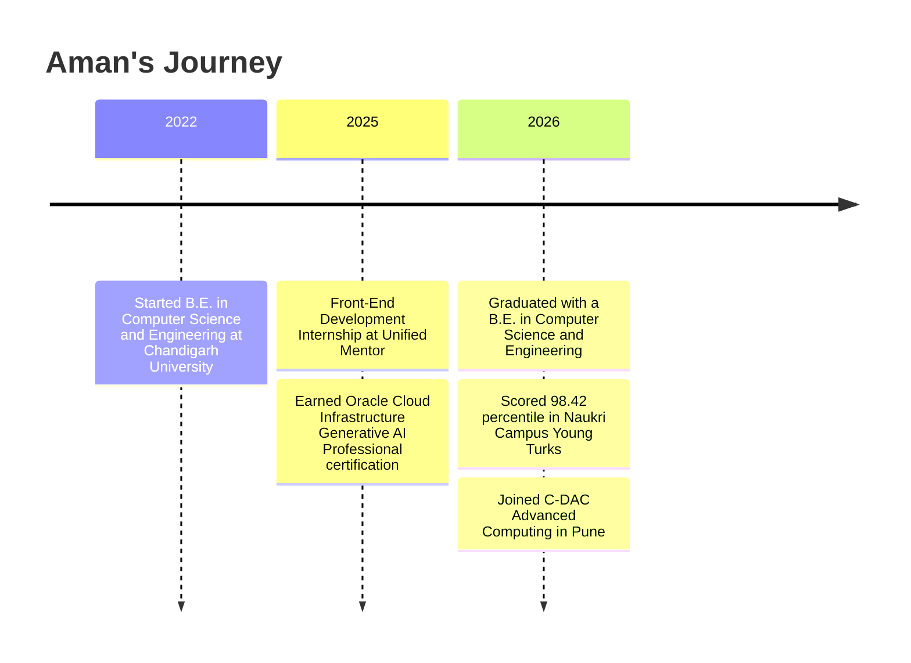

<div align="center">


<a href="https://github.com/amanbansal1506">
  
</a>

<br/><br/>


<br/><br/>

<a href="https://www.linkedin.com/in/aman-bansal-464b6a270/"></a>
<a href="https://leetcode.com/u/amanbansa/"></a>
<a href="https://amanbansal1506.github.io/VibeConnect/"></a>

</div>

---

## 👨‍💻 whoami

```js
const aman = {
  name: "Aman Bansal",
  role: "Full-Stack Developer",
  education: [
    "B.E. in Computer Science and Engineering, Chandigarh University",
    "PG Certification in Advanced Computing, C-DAC Pune (in progress)",
  ],
  certified: "Oracle Cloud Infrastructure 2025 Certified Generative AI Professional",
  achievements: ["98.42 percentile, Naukri Campus Young Turks 2026"],
  stack: ["React", "Next.js", "Node.js", "PostgreSQL", "Redis", "Socket.IO"],
  buildsWith: ["Java", "TypeScript", "Spring Boot", "OpenAI API"],
  openTo: "Software Developer / Full-Stack roles",
};
```

## 🗺️ My Journey



## 🛠️ Tech Arsenal

| | |
|---|---|
| **Languages** |  |
| **Frontend** |  |
| **Backend** |  |
| **Databases** |  |
| **Cloud & Tools** |  |

## 🚀 Featured Projects

<p align="center">
  <a href="https://github.com/amanbansal1506/NetworX"></a>
  <a href="https://github.com/amanbansal1506/TripGenie"></a>
  <a href="https://github.com/amanbansal1506/VibeConnect"></a>
</p>

- 🌐 **NetworX**: professional networking platform with a feed, connections, and messaging. Redis caching makes cached feed reads ~25x faster (~500 ms down to ~20 ms).
- ✈️ **TripGenie**: AI trip planner that turns a short chat into a personalized day-wise itinerary and hotel recommendations, built on structured JSON-mode LLM responses.
- 💬 **VibeConnect**: real-time chat app with room-key based chat rooms and instant messaging. [Try the live demo](https://amanbansal1506.github.io/VibeConnect/).

## 📊 GitHub Stats

<div align="center">


</div>

## 🐍 Contribution Snake

<div align="center">

<picture>
  <source media="(prefers-color-scheme: dark)" srcset="https://raw.githubusercontent.com/amanbansal1506/amanbansal1506/output/github-snake-dark.svg" />
  <source media="(prefers-color-scheme: light)" srcset="https://raw.githubusercontent.com/amanbansal1506/amanbansal1506/output/github-snake.svg" />
  
</picture>

</div>

## 🧩 LeetCode

<div align="center">


</div>

---

<div align="center">


### ⭐ Thanks for stopping by. Let's build something great together.


</div>
